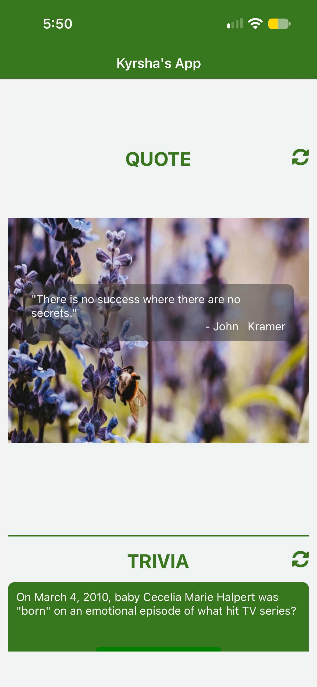
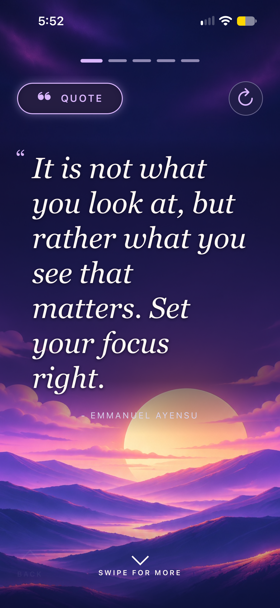
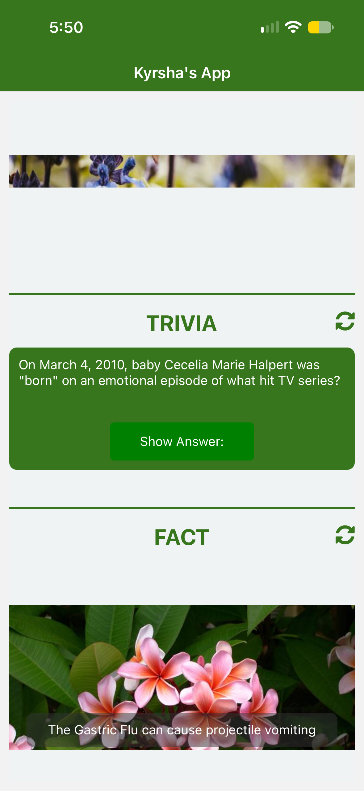
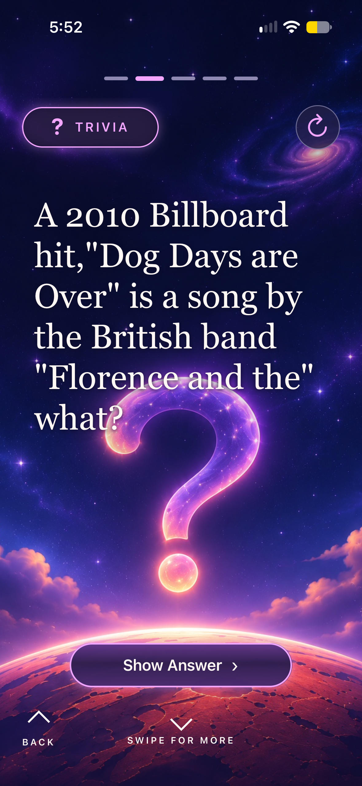
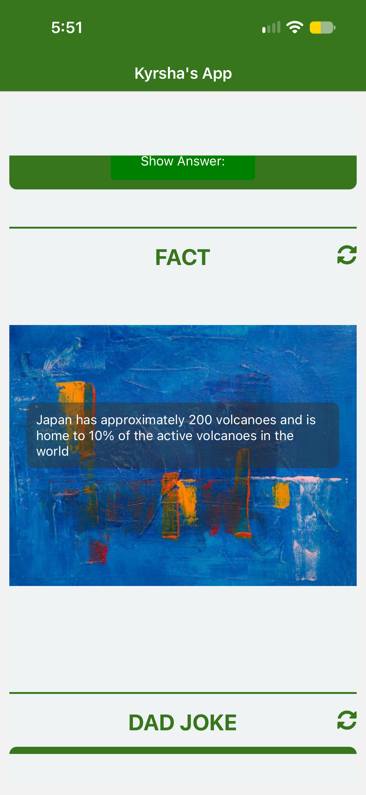
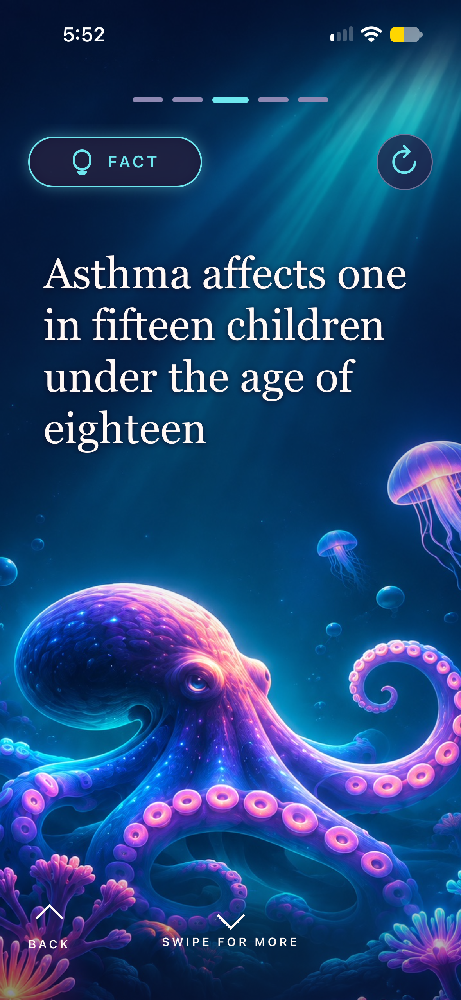

# Kyrsha's App

Originally built for a friend who wanted daily quotes, information and inspiration, this Expo app evolved from a JavaScript card feed into **Afterglow**, a cinematic, vertically paged experience. The two versions remain independently runnable. Human direction, bounded engineering pilots and review shaped the work.

## Before and after

| Original at the root | Afterglow |
| --- | --- |
| **Quote**<br> | **Quote**<br> |
| **Trivia**<br> | **Trivia**<br> |
| **Fact**<br> | **Fact**<br> |

These owner-supplied captures pair the same categories, not the same random content. The current root app includes compatibility updates and uses live content; it is not a byte-for-byte historical build. Capture device, exact revision and Afterglow content mode have not been independently established. The owner reviewed the comparison and said the material looked good; draft PR review remains.

## Run the apps

Use Node 22.23.4 and npm 10.9.9. Run the original app from the repository root:

```sh
npm ci
npm start
```

The original app serves Metro on port 8082. Its card text and random images use the root `.env` variable `EXPO_PUBLIC_API_KEY` for API Ninjas. Expo public environment variables are included in the app bundle and must not be treated as private. The free-tier image requests are unfiltered. If the key or network is unavailable, cards show an unavailable message and can be retried.

Run Afterglow independently in a separate terminal:

```sh
cd modernization/expo-next
npm ci
npm start
```

Afterglow uses port 8081. Both apps require an Expo Go client compatible with SDK 58. Afterglow defaults to mock content; its optional live-local mode uses an explicit opt-in and separate local configuration. `npm start` disables dotenv. See the [live-local guide](docs/migration/expo-next-local-content.md) for mode gates and the direct command. Use only a limited demonstration key; client-side keys are not secret.

## Architecture and workflow

The original SDK 49 JavaScript app used navigation and cards for quotes, trivia, facts, dad jokes and bucket-list ideas. A separate TypeScript Expo project introduced a typed content-provider seam, per-card asynchronous loading and tests. Afterglow added vertical chapters, artwork and adaptive typography. The root app was later compatibility-updated to run alongside it; historical source remains in Git. The [architecture evolution](docs/portfolio/architecture-evolution.md), [design roadmap](docs/design/afterglow/implementation-roadmap.md) and [delivery report](.agentic/reports/issue-32-legacy-showcase.md) document the decisions and limits.

The owner set direction, reviewed the experience and retained acceptance and merge authority. ChatGPT supported planning and review; Codex carried out scoped implementation and testing. GitHub issues and pull requests, OpenSpec plans and Gortex-assisted navigation supported the work. Human feedback changed both the visual direction and the legacy restoration approach. Read the [agentic retrospective](docs/portfolio/agentic-retrospective.md).

## Verification and limitations

The delivery report last recorded 140 modern and 5 root Jest tests passing; these are historical results, not tests rerun for this documentation. See [verification](docs/verification.md) for the root harness. The owner's phone confirmation for the original preceded dependency alignment; post-alignment device acceptance and detailed visual review remain unconfirmed.

This is a completed portfolio-oriented modernization, subject to final owner acceptance and merge. It is a local demonstration. Production content infrastructure, standalone distribution, formal performance and assistive-technology checks, native preservation verification and moderate dependency audit findings remain open. The public client key is not a production secret boundary.
