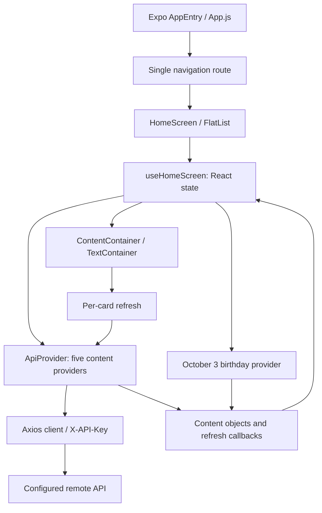

# Architecture

Status: observed source baseline for [issue #1](https://github.com/dvale94/kyrshas-app/issues/1), audited November 9, 2026 (America/New_York), at `ac2e11d72b6e1665c80077d21cd67a635f362fe0`. No runtime/device validation. Inferences and unknowns are labeled below.

## Entry points and boundaries

| Boundary | Observed implementation and evidence |
|---|---|
| Bootstrap | `package.json` points `main` at `node_modules/expo/AppEntry.js`; that Expo entry loads root `App.js`. `babel.config.js` selects `babel-preset-expo`. |
| Navigation | `App.js` imports gesture-handler first, creates a React Navigation stack inside `NavigationContainer`, and registers one screen, `Kyrsha's App`, as its initial route. It uses `@react-navigation/stack`, not the separately declared native-stack package. |
| Screen | `src/screens/HomeScreen/HomeScreen.js` renders a `SafeAreaView` and vertical `FlatList`, with stable content IDs as keys. It prevents automatic splash dismissal and hides the splash when the returned data array is nonempty. |
| State/orchestration | `src/screens/HomeScreen/useHomescreen.js::useHomeScreen` stores a content object in React state and returns `Object.values(data)`. Its mount effect starts five provider calls concurrently with `Promise.all`, preserving quote, trivia, fact, dad-joke, bucket-list order. October 3 adds birthday content first through `getBirthdayData` in `src/screens/HomeScreen/birthdayData/data.js`. |
| API adapter | `src/api/ApiProvider.js` builds display objects with `id`, title, text, optional image/author/answer, and an `onRefresh` callback. Refresh replaces one named state entry with a functional state update. |
| Transport | `src/api/axiosConfigs.js` creates one Axios client using `EXPO_PUBLIC_API_URL` and sends `EXPO_PUBLIC_API_KEY` in `X-API-Key`. Its response interceptor logs and rejects errors. No explicit timeout, retry, or response-schema validation is configured here. |
| Presentation | `src/screens/HomeScreen/components/ContentContainer.js` renders a title, refresh action/spinner, image and text. API images are treated as base64 JPEG; the birthday title selects a local image source instead. `TextContainer.js` renders optional attribution and a local Show/Hide Answer toggle. |
| Assets | `assets/` contains icons and splash art, including duplicate-named icon files. `src/screens/HomeScreen/birthdayData/images/` contains ten tracked WebP images. These personalized assets must be preserved without reproducing personal content in reports or fixtures. |

## Data flow and external API

`eas.json` preview configuration identifies the HTTPS host as `api.api-ninjas.com`. The app depends on its REST endpoints; the repository contains no backend/proxy implementation. Provider account ownership, entitlements, quotas, uptime, licensing, and live response contracts were not verified. No live requests were made.

| Provider in `src/api/ApiProvider.js` | Requests and assumptions |
|---|---|
| Quote | `/randomimage?category=nature&width=375&height=667`, then `/quotes?category=...`; randomly selects one of six quote categories. |
| Trivia | `trivia?category=...` (no leading slash); randomly selects one of four categories. |
| Fact | `/facts`, then an abstract `/randomimage` request. |
| Dad joke | `/dadjokes`. |
| Bucket list | `/bucketlist`, then an abstract `/randomimage` request; expects an object with `item`. |

The five regular providers make eight HTTP requests in total on initial load. `parseApiResponse` deep-copies `response.data[0]` for quotes, trivia, facts and jokes; empty or changed responses can throw. Image response encoding is assumed by the UI, not validated by a live test.

## State and security boundaries

Observed runtime state is in memory: the hook's content object, per-card refresh state, and answer visibility. No storage read/write or user login appears in the inspected runtime path. AsyncStorage is declared in `package.json`; its presence alone does not establish a persisted schema. Existing installed-app data and native customizations remain unverified. No auth flow, payment flow, notification flow, or deep-link handling was found in the inspected entry/screen/API path; do not treat this bounded inspection as proof that deployed binaries have none.

A nonempty credential remains in tracked `eas.json` under the preview environment. Treat it as compromised. Its value was not reproduced or used. Expo documents that `EXPO_PUBLIC_` values are embedded in readable client bundles; moving the same key to an EAS secret would not make its client-side use private. Owner-controlled revocation/rotation and a server-side proxy where required are proposed separately. The full Axios error logging may also expose request headers/configuration; this is a source-based risk, not a reproduced leak. See [Expo environment-variable security guidance](https://docs.expo.dev/guides/environment-variables/).

## Build and deployment boundaries

`app.json` declares app version `1.0.0`, slug `kyrshas-app`, iOS bundle ID `com.dvale1994.kyrshasapp`, portrait/light presentation, tablet support, splash/icon assets, and EAS project ID `1eedc0a6-a315-467a-a326-ce48cba82b2c`. It has no explicit Android package, URL scheme, or config-plugin list. Its web favicon points to nonexistent `assets/icon.png.png`.

`eas.json` requires CLI `>= 5.3.0`. Development uses a development client and internal distribution; preview uses internal distribution and declares both public API variables; production build and submit profiles are empty. Development/production API variables may exist externally, but that was not checked. `expo-dev-client` is neither declared nor locally installed, so the development profile needs validation before use.

Git tracks no `ios/` or `android/` files. This machine nevertheless has an ignored `ios/` directory with an Xcode project/workspace, Pods, Podfile/lock and build artifacts; Android is absent. Whether iOS contains manual changes is unknown. Do not delete or regenerate it on the assumption that the tracked repository captures everything.

`.github/workflows/ci.yml` validates only the starter structure and Python syntax; it does not install or test the application. See [verification](verification.md) for executed results and [migration audit](migration/expo-audit.md) for compatibility risks. Deployment and native regeneration require separate approval.
