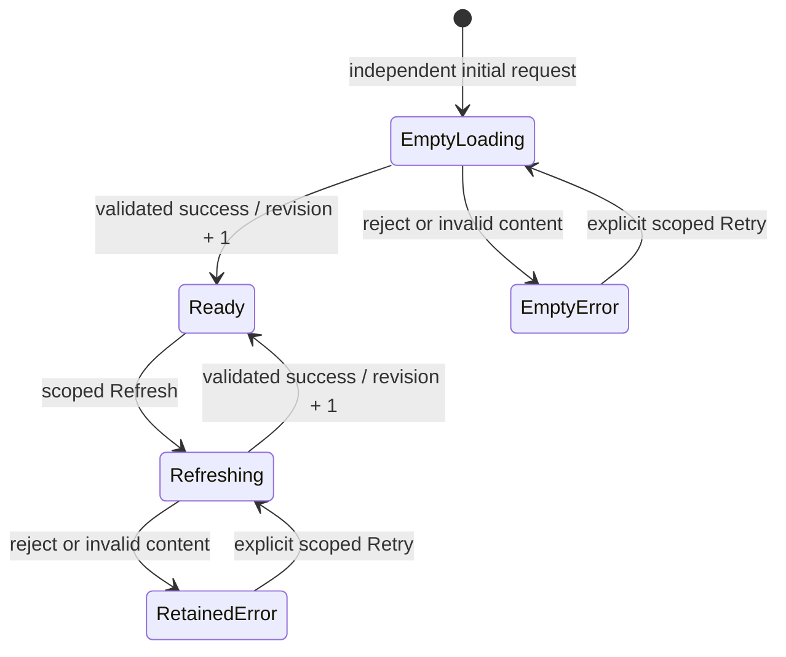

# Afterglow chapter interaction model

Documentation target for [issue #23](https://github.com/dvale94/kyrshas-app/issues/23), not running behavior. [Current contracts](../../migration/afterglow-design-audit.md), [visual layouts](visual-specification.md), [feasibility/accessibility](feasibility-accessibility.md). IDs, data validation and provider/hook semantics stay unchanged. Values and mechanics below are recommended implementation defaults for bounded future approval.

## Finite vertical navigation

One home, five positions: index 0 `quote` → 1 `trivia` → 2 `fact` → 3 `dad joke` → 4 `bucket list item`. Open at 0 on a fresh process/home mount. No sixth page, infinite wrap, auto-advance, daily selection, deep link, persisted index or new navigation route. App background/foreground keeps the current mounted session/index/content; process relaunch starts fresh mocks or the already-approved source mode. “Back” in this model means Previous chapter; do not invent an iOS system back stack or exit behavior.

| Input / event | Target outcome |
|---|---|
| Swipe upward on a non-overflowing chapter | Settle to next chapter if available; a deliberate gesture advances at most one chapter, even after a fast flick |
| Swipe downward | Settle to previous chapter if available; not pull-to-refresh |
| Short/cancelled drag | Settle back to current page, with no content reload, answer reset or entrance replay |
| First page downward / last page upward | Stay at boundary, no wrap and no refresh; restrained platform boundary feedback, no custom bounce required |
| Next / Previous button or equivalent accessibility action | Same single-step target as swipe; buttons have names “Next chapter, Trivia” / “Previous chapter, Quote” etc.; unavailable boundary direction is disabled with matching state |
| System screen-reader scroll gesture | Same bounded next/previous action in normal page mode; in overflow reading mode scroll the text region and retain explicit chapter buttons/actions |
| Rapid navigation while settling | Commit one navigation at a time; ignore/coalesce additional triggers until settled, then accept the next deliberate action; never duplicate speech or publish a fractional index |
| Size/inset/text-size change | Recalculate page extent and text overflow; retain current ID; realign to its new boundary without visible skip or content/provider reset |
| Content update or answer expansion | Retain active ID/progress; recompute reading geometry; do not move to another chapter |

Use the measured pager viewport extent H and fixed page boundaries `0, H, 2H, 3H, 4H`, accounting for insets once. Commit active index only on settled selection, clamp to 0–4. Do not derive semantic selection from every scroll frame or a possibly fractional transient offset. During a drag the last settled index remains selected. Disable paging for VoiceOver if it conflicts with reading; explicit chapter navigation is sufficient. No haptic dependency or new permission is required.

Progress is **location, not completion**: five segments, selected segment visibly different in shape/size as well as accent, exposed as a single readable “Trivia, chapter 2 of 5” summary. Segment graphics are not tiny buttons and do not indicate loaded/read/completed counts. Loading or error never changes position. Previous/Next remain visible, at least 48×48 targets; at large type they may become full-width labeled controls. Cue “Swipe for more” applies only when swipe paging is available and there is a next chapter; overflow mode uses “Scroll to read · Next chapter”; last chapter uses a finite end cue. Do not require a hidden gesture to return.

## Automatic entrance and revisits

On initial active chapter, show category, position and controls immediately, regardless of request state. Once validated content exists, reveal it automatically with an optional one-shot opacity transition (recommended 180–240ms) and at most 8pt vertical translation. There is no cover, mandatory tap, minimum display timer or extra mock delay. Content is in the accessibility tree immediately; animation cannot gate reading/actions. All five independent loads still start on home mount, not on first swipe.

Track entrance presentation per category/successful revision within the current session. If a chapter loads offscreen, keep its content; first visit can play its entrance once. Revisit the same revision immediately, with no replay, no refetch and no resetting text/answer/scroll. A user refresh that succeeds on the active chapter may use a brief crossfade after commit, with controls never blocked by motion. A successful offscreen refresh is ready on return and may use one first-view entrance for that new revision. Failed/cancelled loads never trigger a success entrance. With Reduce Motion, show the final state immediately; no parallax, translation, automatic smooth page travel or decorative loop. Navigation is still explicit and usable.

## State ownership and transitions

Data remains five slots of idle/loading/ready/error, optional last-good content and successful revision. Keep the provider and hook mounted above presentation; page identity cannot be a provider identity. Separate presentation state is active ID, per-chapter read offset and trivia answer visibility tied to its successful revision/provider session. Keep five lightweight pages mounted initially; if a later implementation virtualizes them, it must explicitly preserve this presentation state and prove equivalent revisits.

| Display state | Text/art and controls | Scope / accessibility |
|---|---|---|
| Initial idle/loading, no last-good | Category world/static dark fallback; optional nonanimated skeleton in body region; visible “Loading Quote…” etc.; refresh busy/disabled; navigation available | Do not show example text as success or wait for all categories. Spinner/skeleton decorative. No explicit startup announcement flood |
| Ready | Complete validated text/author, optional trivia control; refresh enabled; world independent of content.image | Preserve canonical category labels even if supplied title differs. No forced success toast |
| Refreshing with last-good | Keep current body, author, illustration and any visible answer; “Refreshing Trivia…” beside spinner; refresh disabled/busy, other controls usable | Suppress duplicate same-ID request before rerender; other categories may overlap; no page jump or blank flash |
| Initial error, no last-good | “Could not load this example.” and readable Retry guidance; no empty answer or fake content; world fallback can remain | Retry named “Retry Fact” etc.; generic accessible error, no response/credential/exception text |
| Refresh error, last-good | “Could not refresh this example.” near category/content, with Retry; current text/author/answer/world stay | Clear busy; error doesn't obscure reading/actions or disappear on a timer; may scroll with reading if space is limited |
| Retry pending | Clear prior error while retrying; loading versus refreshing depends on last-good; same successful revision until validated success | Only affected ID loads; no automatic retry/backoff loop or silent synthetic fallback |
| Retry success | New content committed atomically, error cleared, busy cleared, revision advanced; answer reset for trivia | Other categories/index unchanged; repeated content is accepted as success; no promise of a unique result |
| Provider replacement / unmount | Fresh source gets fresh slots; obsolete success/error cannot publish or announce as current work | Retain current navigation position only if home remains mounted; content session/read offsets/answer reset for the new source. No screen can show old-provider data as new-source content |

Existing status/error copy may remain generic “example” wording to preserve behavior during early pilots. Any later copy adjustment must remain honest about mock/live-local mode and be covered by synthetic state tests. “Daily” never promises a unique item each day. No art or paging state can convert an API error into mock success.

Request lifecycle invariants: start all five independently; at most one pending operation per ID; validate before publication; increment revision only after success; ignore obsolete effect generations; preserve retry revision after failure; no live-provider call during this design pilot. Initial failures do not block other categories or startup. Last-good is in memory only, not disk cache or offline persistence.

## Trivia answer contract

| Trigger | Required answer behavior |
|---|---|
| First valid question or new provider session | Hidden; Show Answer button with `expanded: false`; answer absent from accessibility tree |
| Show Answer | Reveal matching answer below question, change control to Hide Answer and `expanded: true`; keep focus on toggle; expose answer next in reading order |
| Hide Answer | Remove answer, return label/state; retain question and focus; adjust reading offset only enough to keep focused control in view |
| Refresh starts | Keep last-good question and its visibility while pending; toggle can still operate on that question |
| Refresh/retry fails | Preserve last-good question and current answer visibility; Retry is available; no revision change |
| Refresh/retry succeeds | Reset to hidden for the new successful revision, including identical returned content; never pair a new question with an old answer |
| Swipe away/back, other category success/failure, layout change | Preserve this revision's visibility; no implicit hide or refetch |
| Rapid Show/Hide during success commit | New revision wins and begins hidden; never apply old-revision visibility to the replacement question |

Never reveal answers for the other four IDs. Do not parse joke text into a second reveal interaction. Missing/blank trivia answer remains a validation error, not an empty reveal panel.

## Overflow and Dynamic Type

The page is a viewport; the reading region can scroll. Measure content after layout/text scaling rather than classify by character count. When content, attribution, error, answer or large type overflows available reading space:

1. Simplify/remove foreground art and decorative spacing. Keep progress/category, full refresh hit area and a bottom Previous/Next strip within safe areas where feasible.
2. Place complete text, author, status and trivia answer/toggle in a bounded vertical reading ScrollView. Disable the **outer swipe pager for that active overflowing chapter**, so ordinary reading swipes cannot unexpectedly navigate. Do not require edge swipes or momentum handoff to escape.
3. Keep visible chapter buttons and screen-reader custom Next/Previous chapter actions available. If chrome itself exceeds compact-height/large-type space, include the category/action row in the reading region; retain a compact position summary and navigation strip. These can wrap/grow; the body region must remain usable, never negative height.
4. Preserve per-chapter reading offset across revisit and failed refresh. Successful replacement starts the new content at its beginning without changing active ID. On font/geometry change retain the closest valid position, clamp it and keep the focused item visible. Trivia Show/Hide preserves question context and minimally scrolls its focused toggle into view.

Do not use `numberOfLines`, ellipsis, clipping, fixed text heights, `adjustsFontSizeToFit` or disabled font scaling to protect the composition. Controls may scroll with content in the compact fallback but must all be reachable. Test shortest and longest body/title/author/answer, Unicode and explicit line breaks at standard and maximum accessibility sizes. This explicit reading mode is a recommended reversible implementation choice; a gesture package is not a substitute for proving the same behavior on iPhone.

## Focus and announcements

Only the settled active chapter exposes content/controls to sequential focus; inactive pages are hidden from accessibility without destroying their state. On a user chapter change, move focus once to its heading/position and announce its name/position through one mechanism; do not also announce every background load. First app entry follows natural focus. Cancel pending navigation focus work if another page wins.

Preserve one settled iOS outcome announcement per explicit refresh/retry, including immediate identical errors/successes. If it completes offscreen, use a short category-qualified outcome without moving focus, replaying an entrance or revealing inactive content; do not announce it again on revisit. Avoid loading speech and simultaneous duplicate live-region/explicit announcements. Trivia reveal uses expanded state plus readable answer, with no competing success announcement. Actual VoiceOver speech ordering is a later required manual check, not established by JSX props.

## Scenario review matrix for future pilots

| Scenario | Acceptance evidence |
|---|---|
| Five loads resolve in arbitrary order, one fails | Fixed page IDs/order, each usable/error/loading slot, no global gate |
| Navigate 0→4→0 by swipe and buttons; cancel a drag; flick rapidly | Settled index/progress exact, bounded one-step navigation, no wrap/reload/reset |
| Reveal trivia, visit all chapters, return; refresh quote then fail trivia then succeed trivia | Visible answer retained until only trivia successful revision resets |
| Refresh twice same tick; overlap fact/joke; switch provider while pending | No duplicate same-ID work, independent busy states, stale results ignored |
| Long question/answer/error at maximum type on compact iPhone | Every character/control reachable, reading swipe never changes chapter, explicit navigation works |
| Reduce Motion toggled during entrance/paging | Immediate final content/position; no ongoing decoration or hidden content |
| VoiceOver chapter/retry/reveal flow, including offscreen settlement | Correct names/state/focus, no inactive focus targets, no startup flood or duplicate outcome speech |

These are future acceptance scenarios. The 04A delivery checks document their completeness; they do not execute or certify the target interaction model.
