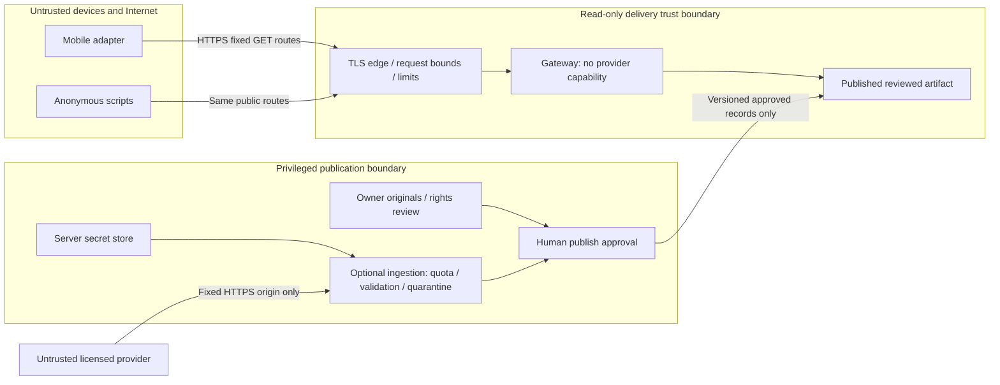

# Secure content threat model — Pilot 03F-A

Date: November 17, 2026 (America/New_York). **Proposed controls, not implemented or security-tested.** [Architecture](secure-live-content-architecture.md), [ADR](../decisions/0002-secure-content-delivery.md), [acceptance matrix](secure-content-verification.md). The complete strict OpenSpec gate passed before this document. [Issue #17](https://github.com/dvale94/kyrshas-app/issues/17) authorizes planning only.

## Assets, actors and trust boundaries

Assets: future provider credentials, provider/host budget, app availability, approved content/provenance, publication integrity, operator access, user privacy and untouched legacy/native state. Public feed content is intentionally public and scrapeable; there is no promise of confidentiality or client authentication.

Actors: legitimate mobile users, unauthenticated scripts/botnets, compromised devices, malicious or compromised upstream, compromised publisher/CI identity, mistaken operator and external provider/host administrators. No user accounts, payments, private content or personal profile collection are proposed. Birthday behavior/date checks/personal messages/photos/private assets are permanently excluded from modern implementation and its tests. Legacy state is preserved.

Host control plane, operator workstation and protected CI environment form an additional privileged boundary; they are not reachable through public read routes. Reader has no secret-store binding, publication mutation capability or arbitrary egress. Ingestion identity cannot alter public routing or billing. Host sees transport metadata; provider sees the job origin and fixed category only, not the device or user history. No provider credential passes through mobile or the read gateway.

## Threat register

Severity is qualitative before controls; acceptance evidence is required before rollout. Owner roles below must be assigned to named people at the gate.

| ID / threat | Impact | Proposed preventive/detective control | Residual / accountable owner |
|---|---|---|---|
| T1 Critical — historic exposed credential reuse | Account abuse, unexpected billing, continued leaked access | Never inspect/use it here; immediate credential-owner revocation if active; audit usage privately; issue a different least-privilege key only after approval | Revocation unknown until owner confirms; credential owner |
| T2 High — new key leaks via Expo, CI, errors or builds | Repeat of T1 | Server-only secret binding to optional ingestion, separate environments, no PR/fork secrets, redacted classified logs, no request-config logging; fixture scanning with synthetic canaries | Host/publisher compromise can exfiltrate secrets; credential/operator owners |
| T3 High — anonymous proxy quota theft / denial of wallet | Provider spend and exhausted content service | No provider calls on reads or cache miss; single-writer atomic≤50/day,≤1,000/month including retries; fail closed on counter failure; no public ingestion trigger | Hosting requests still cost money; botnets bypass per-IP; operator/billing owner |
| T4 High — public request storms / resource exhaustion | Availability loss and host spend | Fixed routes/method/body/header/JSON bounds, edge throttle60/min/IP across categories, deadline/CPU/concurrency limits, host quota/cap, no cache-busting; alert and serving kill switch | Shared NAT unfairness; global attack may exhaust free quota or cause intentional cutoff; operator |
| T5 High — SSRF, open relay or redirect/header credential leak | Internal metadata access, secret exfiltration | No client URL/category forwarding, no public fetch path; optional job fixed HTTPS host/path/port443 with redirect disabled, validate TLS; never forward inbound headers; no remote media in v1 | Upstream DNS/host compromise; fixed outbound-origin review and network-private range rejection in any future generalized fetcher; security owner |
| T6 High — harmful, false, private or malicious text | User harm, privacy/licensing issues | Schema/type/size bounds, plain text only, manual safety/factual review and provenance before publish, no private assets, no executable markup/autolinks; no risky bucket-list suggestions; controlled takedown | Human review misses context/errors; safety filters are incomplete; content owner |
| T7 High — license violation or stale withdrawn content | Takedown/legal cost and loss of service | Rights ledger, approved retention/distribution/attribution, 24h fresh/7d hard age or earlier rights expiry; no Free/Developer provider caching; purge on withdrawal | Already delivered text cannot be recalled; last-good in-memory retention needs compatible rights or separately approved expiry behavior; content/rights owner |
| T8 High — poisoned cache or unauthorized publication | Wrong content shared widely | Publish from protected review identity only; validate artifact hashes/schema; read-only runtime, exact category cache keys; ignore untrusted cache headers; cache only validated200, errors no-store; separate staging/production | Compromised reviewer/control plane remains privileged; operator/reviewer |
| T9 Medium — upstream outage, 429, malformed or giant response | Failed publication, retry storm | Stream≤64KiB decompressed;3s attempt deadline,≤1 jittered retry within8s item budget,2 simultaneous calls; atomic budget;15min circuit after3 transient failures; no retries on auth/schema errors | Licensed content eventually expires; serve reviewed originals only if approved; operator |
| T10 Medium — privacy leakage via logs/telemetry | User linkage and unnecessary data collection | No body/auth/IP/device/query logging; daily abuse pseudonym≤24h if needed, sampled operational logs≤7d and aggregate metrics≤30d; host policy review | Edge may retain IP despite app settings; privacy owner must assess host controls |
| T11 High — compromised deployment/CI/publisher identity | Full service or credential compromise | Protected environment/manual approval, least-privilege deployment identity, branch review, pinned audited tooling in follow-on, no production secrets in normal CI, account MFA and recovery ownership | Account admin can override controls; owner access reviews and offboarding |
| T12 Medium — stale mobile completion or unsafe error display | Wrong card, leaked upstream detail, frozen retry | Existing replaceable provider/normalizer and independent hook, adapter validation/deadline/abort; generic typed failures; preserve 03C/03D regressions | Current hook preserves last-good until changed/replaced; do not assert remote deletion; mobile owner |
| T13 High — accidental native/legacy/owner mutation during planning | Loss of untracked state or expanded ATS | Documentation allowlist, clean kickoff index, fetched base, Gortex guarded edits; compare native metadata without reading file contents; backup untouched; no Expo/Xcode/prebuild/Pods | Metadata equality is not a bytewise/content audit; known tool effects disclosed; pilot author |

Threats T3/T4 correspond to [OWASP API4 resource-consumption risks](https://owasp.org/API-Security/editions/2023/en/0xa4-unrestricted-resource-consumption/) (public reference accessed November17,2026). CORS is a browser policy, public installation tokens are copyable, and device attestation is at most an abuse signal. Do not introduce login/attestation as an assumed fix or claim that device-held keys provide secrecy.

## Credential incident and lifecycle plan — owner action only

The legacy credential is treated as compromised based on the existing audit and issue, not by reading or testing it. No credential-bearing EAS/config/environment file was opened for this pilot, and no real key was scanned against new text. [Expo environment-variable guidance](https://docs.expo.dev/guides/environment-variables/) establishes that public-prefixed variables are readable in compiled applications; moving the same value into an EAS secret while still using it in client code does not change that boundary.

1. **Credential owner, urgent if active:** through the authenticated provider dashboard, revoke the exposed key immediately. Do not send it to the agent/chat/issue. Privately review usage, billing, access and unexpected activity; contain account access and record a redacted incident timestamp/ticket. No test call is necessary to establish exposure. Revocation may stop legacy live content; owner acknowledges that impact.
2. **Owner-authorized cleanup, separate scope:** remove credential-bearing tracked configuration references safely, check build artifacts/logs/caches/distributed binaries and downstream copies, and use approved secret scanning without printing values. Deleting tracked text does not revoke prior copies. Do not rewrite Git history, delete native state, edit legacy files or rotate credentials in this planning pilot. History cleanup, if desired, needs separate destructive-action approval and coordination.
3. **Only after architecture/rights approval:** credential owner creates a distinct key (not a renamed/recycled exposed one), scopes it if provider supports scopes, sets owner-approved quota/billing controls, and places it directly into the approved server store. Do not transmit it through public Expo variables, PR bodies, fixtures or ordinary CI. Use separate staging/production identities; mock tests require no real key.
4. **Operations:** maintain owner-only inventory of account, environment, purpose, admins, issued/expiry/review timestamps and revocation procedure without raw values. Review access monthly and on team departure. Planned replacement/incident rotation is done by credential owner in provider/store, validated through separately approved safe smoke, then old new-generation key disabled; never validate the compromised historic key. No automatic rotation promise without provider support.
5. **Evidence:** record only completion/owner/date/incident reference, not values, hashes of secrets or request headers. Key status remains **unknown/pending owner**, not “secured” merely because this PR passes.

## Operational containment and recovery

- **Provider auth failure or exposure:** stop optional ingestion, alert credential owner, preserve redacted failure class, revoke the affected new-generation key through owner account. Public reads do not need that key. Halt provider-derived serving if entitlement/rights no longer permits retention; original reviewed records can continue only if cleared.
- **Unsafe/unlicensed record:** disable serving for affected category, revoke publication, purge edge variants, remove/quarantine artifact and republish reviewed allowed version. Since caches can retain prior responses for up to5min and delivered text is public, test purge propagation and document residual device retention. Do not represent takedown as remote erasure.
- **Attack or spending alarm:** stop ingestion, lower public capacity or disable serving at edge; confirm all origin/preview aliases protected. Enforce host spend cap; do not approve auto-upgrades. Prefer safe outage over unbounded spending. Account-wide cap may disrupt other services and must be owner-approved.
- **Publisher/store outage:** do not bypass validation or pull upstream on demand. Serve an unexpired approved artifact or503. Restore last approved artifact only if still licensed/safe; do not extend timestamps automatically. Rollback never undoes revocation.
- **Mobile rollback:** keep mock provider selectable in a future reviewed adapter change. A new app build/rollout is separately approved, not an implicit remote-config system. Current pilot changes no mobile wiring.

Before operational rollout, assigned owners must demonstrate quota race tests, malformed upstream rejection, kill switches, budget exhaustion, rights expiry, purge and restoration in an isolated approved environment. Local planning checks are not penetration tests, live provider verification or native runtime acceptance. [Roadmap](secure-content-roadmap.md) retains the explicit approval stop.
